## 【1】

看久了我发的东西的朋友都知道，我有一个个人博客站点 [leewendao.otterstack.cn](https://leewendao.otterstack.cn) ，我会把我写过的绝大多数文稿丢在上面，作为一种记录与存档。

因此我有在微软的搜索引擎必应（bing.com，虽然我觉得大部分人都知道这个搜索引擎，但还是标一下）上注册我的博客站，稍微针对它做过一些SEO的优化。

于是基本上每隔一段时间我就能收到必应发到我邮箱的邮件，用于提醒我近期我的博客站在bing上的搜索表现：

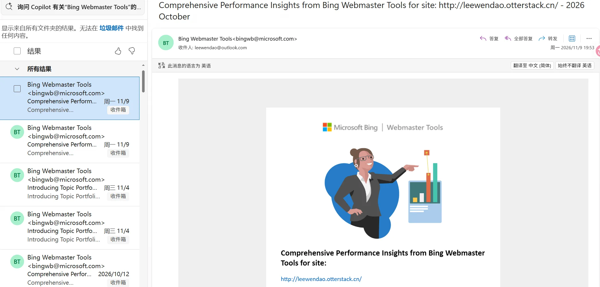

于是在某天，**当我好奇大家平常会因为什么关键词搜到我的博客**、而后点开必应提供的可以查看被搜索数据的 webmaster 的时候，我沉默了，因为我看到我博客站被索引的关键词里，某些不得了的 R18 词汇名列前茅：

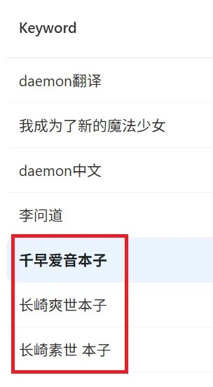

当我把目光往下挪，一个更令我大受震撼的搜索词映入我的眼帘，**“用玉米投手定身长崎爽世然后XX”**：

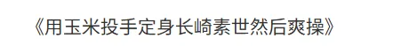

上次看到这么猎奇的标题，还是几年前还在读书的时候，我天天能在百度的 bangdream 吧里看到我的某位从锁妖塔里逃出来的A处朋友在那里发的一堆猎奇同人文，由于过于逆天并且我无法接受他的艺术，所以在此按下不表。

接下来往下看，我深深地感受到了大家是有多么的压抑，我能看到各种奇奇怪怪的不同xp的词：

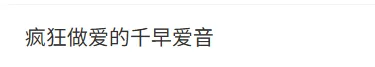

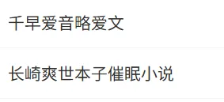

并且更绝的是，从必应的搜索词里好像还能看到 role play 玩法的长片段，感觉像是在用 AI 玩什么不得了的东西的时候，AI自己去搜了：

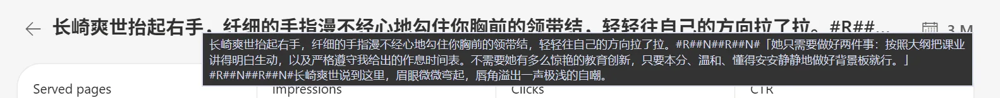

**还有一些词因为过于不堪入目，就不一一列出了**。

而之所以上面会有这么多的成人向内容，只是因为我在自己的博客上，挂了当年写的 Mygo 同人文，**由于同人文这块一般都圈在 Lofter 这样的私域网站里，一般不会被搜索引擎索引，所以我的同人文就莫名其妙地容易被涉及到的主角的关键词搜到**：

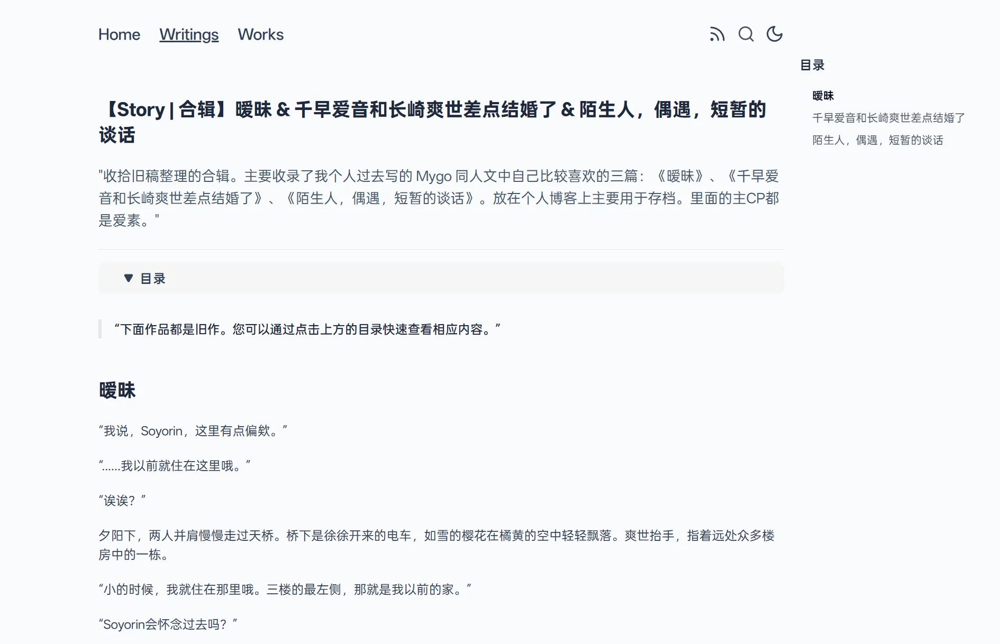

看着后台数据里各种和 Mygo 相关的成人向词汇，我只能扼腕叹息：**唉，大家还是太压抑了**。

## 【2】

必应后台提供了完整的数据导出功能。因此我把数据导出，扔给了我的 AI 哈基米（Google 的 Gemini），从中分析出了不少有意思的东西。

在过去的几个月里，我的博客被别人搜索到的关键词里，**我当年写的Mygo&爱素相关的同人文的被搜到的占比其实并不高**：

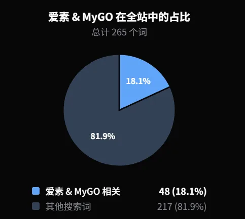

但是在**同人文相关的搜索关键词上，R18关键词的占比是最高的**：

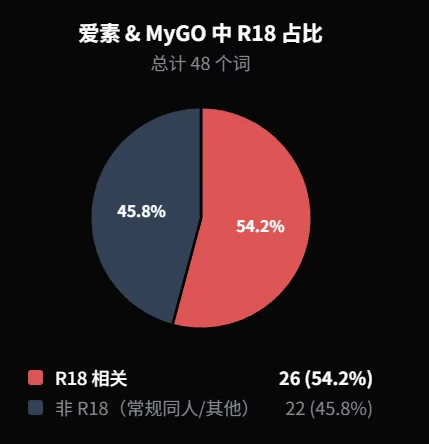

然后令人欣慰的是，猎奇的东西还是小众的，在我们这种少样本的情况下，也就只有大概四分之一的搜索量：

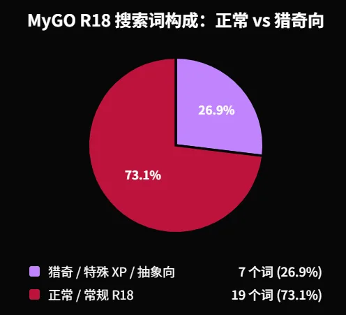

最后闲来无事，让我们 Google 最有人味的**氖基米** （Gemini 4 Neon，因为 Google 的 AI Gemini 在四代以后用化学元素表去命名模型，所以根据模型型号的不同，从原本的哈基米变成了氢基米、碳基米这样的坊间称呼）大人锐评了一下：

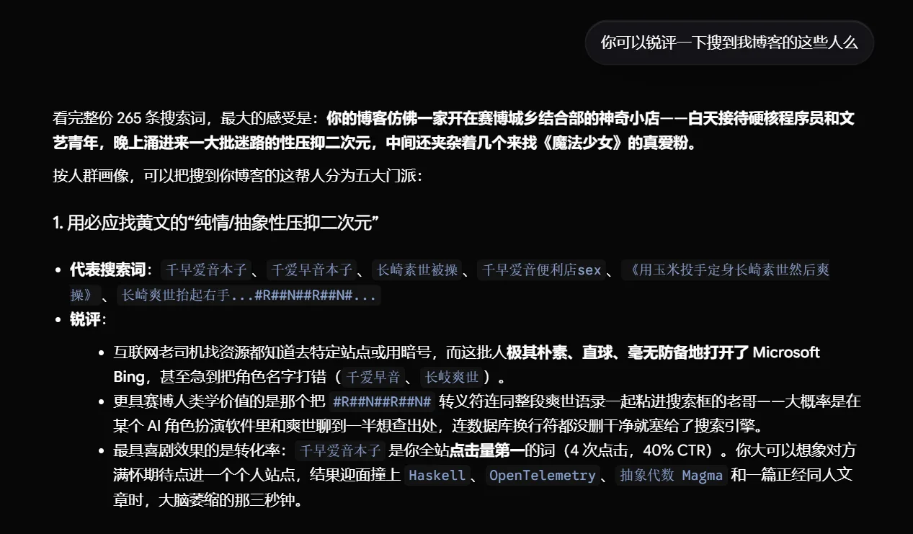

好了，话说到这了，**我要给我当年写的同人文打一下广告了**。

如果你喜欢诙谐轻松的欢喜文，我会给你推荐我的得意之作[《千早爱音和长崎爽世差点结婚了》](https://leewendao.otterstack.cn/writings/story/mygo-collection#%E5%8D%83%E6%97%A9%E7%88%B1%E9%9F%B3%E5%92%8C%E9%95%BF%E5%B4%8E%E7%88%BD%E4%B8%96%E5%B7%AE%E7%82%B9%E7%BB%93%E5%A9%9A%E4%BA%86)。

如果你喜欢清水文，不妨来看我个人最喜欢的含蓄的感情表达[《暧昧》](https://leewendao.otterstack.cn/writings/story/mygo-collection#%E6%9A%A7%E6%98%A7)，以及今年有个B站的老师帮我转成的视频版：[https://www.bilibili.com/video/BV1hynV6GEtL](https://www.bilibili.com/video/BV1hynV6GEtL)。

如果你喜欢一点带着荒诞的文字，我会给你推荐[《陌生人，偶遇，短暂的谈话》](https://leewendao.otterstack.cn/writings/story/mygo-collection#%E9%99%8C%E7%94%9F%E4%BA%BA%E5%81%B6%E9%81%87%E7%9F%AD%E6%9A%82%E7%9A%84%E8%B0%88%E8%AF%9D)。这篇很短，但是却是我最满意的一篇。

偶尔会有点怀念当初还没工作，又恰好被 Mygo 这部优秀的作品点燃创作欲的日子。

## 【3】

当然，除了 mygo 相关的同人文外，让氮基米去分析我的博客站点的其他被索引的关键词，还有其他的一些让我感到欣慰的东西。

我的博客的被索引流量最高的内容，是当初从 HackerNews 上记录下来的关于 daemon 这个词在计算机领域中是如何被翻译为“守护进程”的一篇笔记。记得当初看到这个内容的时候，我去互联网上搜还真搜不到类似的内容；但是现在用 AI 去搜索，发现基本上都能搜到正确的材料，真是令人感慨。

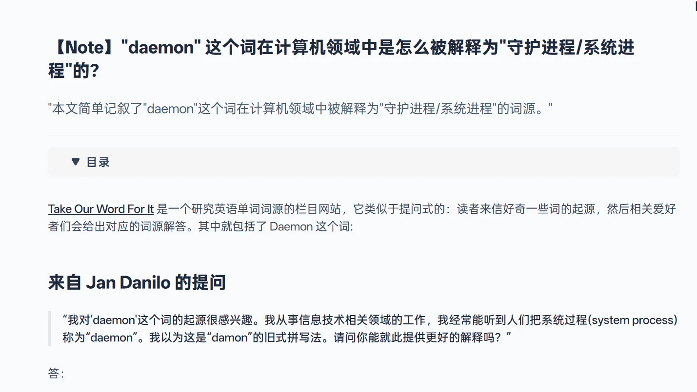

以前在我很喜欢待的一个豆瓣小组里撰写的如何使用 markdown 在豆瓣上进行写作的文章，成功帮助到了一个翻了整整三页必应才找到我这篇文章的人：

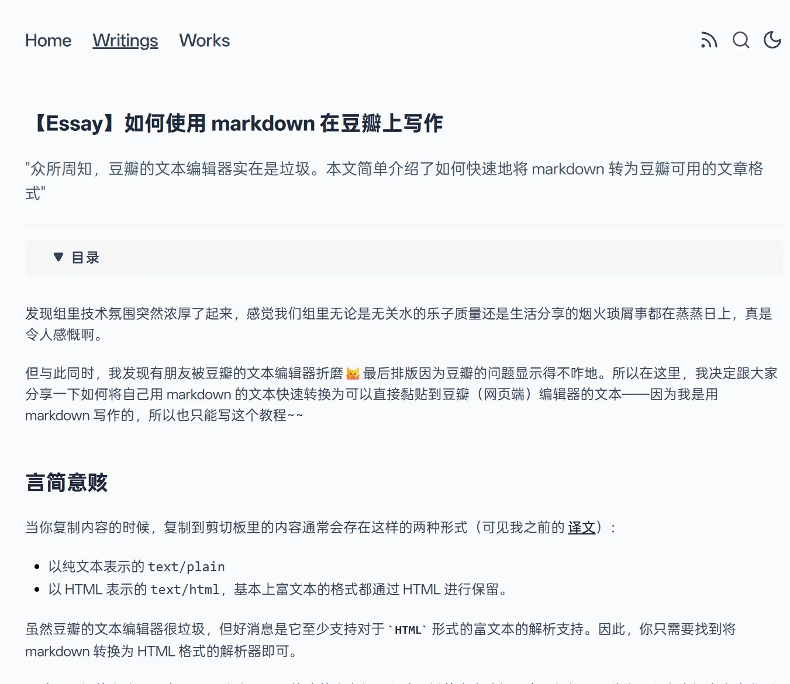

我是国内最早关注到  **《杀死公主》（Slay The Princess）**  这款游戏的一批人，在当初它还没有汉化的时候就啃了生肉，并且写了关于它的解析文章（是国内最早的一篇完整解析）。至今这篇文章还是必应搜索上的第一名，我个人博客站上的备份时不时还有流量，Steam社区上的文章也偶尔还会有人评论：

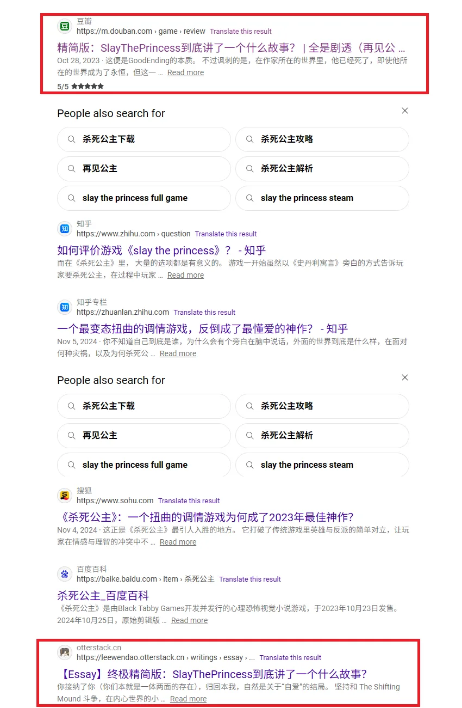

还有很多当初AI不发达的时候的个人翻译文章、奇奇怪怪的报错的个人记录的笔记，**至今都能看到当初我扔在博客站上的犄角旮旯的文章被不同方式搜索到**。

我想起了两年前，我在重新把博客捡起来的时候写下的话：

>我想我应该感谢那些在互联网上长期无私奉献的素昧平生者，如果不是他们写了那么多文章分享他们的知识，我想应该就没有如今的我。
>
>这种精神是真正的互联网精神。我不敢说我是受这种精神感召的继承者，只能说曾经有人为我打伞，因此我想让更多人不被风吹雨淋。于是在大学期间我也零零散散地写了一些技术文章，偶尔会在已经没落的论坛与贴吧里回帖，尝试帮到一些人......这个平台三四篇，那个地方八九篇，只能说七零八落得也许哪天自己都忘了。
>
>于是，现在的我就想重新捡起我的博客站点了。

虽然现在 AI 发展得那么快，基本上我自己平常都不用搜索引擎搜东西了，**在互联网上放着一个博客站往上面丢自己的东西的价值可能会随着时代的发展越来越那么不重要** ， 但是看着自己写过的东西还留在互联网上，还有那么一些明显是人点进来的痕迹，或是明显被 AI 搜索到然后又能间接地帮助到其他真实的人，我感觉就足够了。

哪怕是搜索 R18 内容误入到我的博客也没事——只要点进来的人发现不是自己想要的东西时不生气就行。