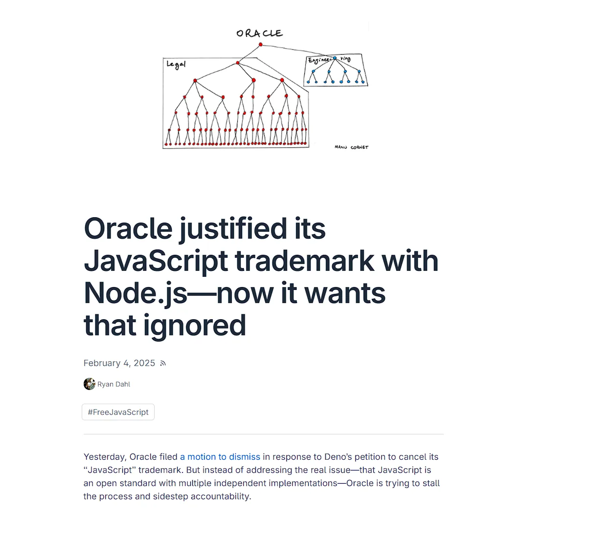
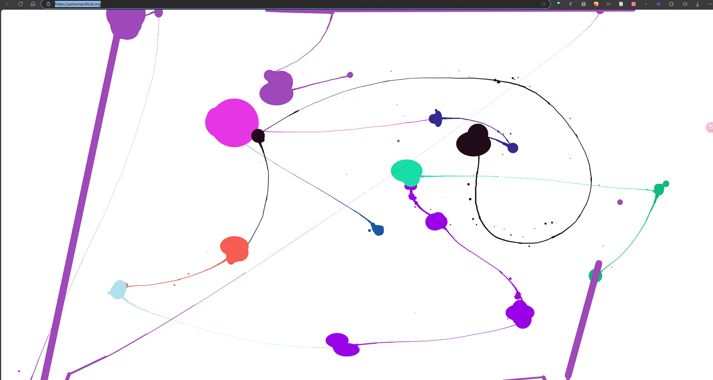
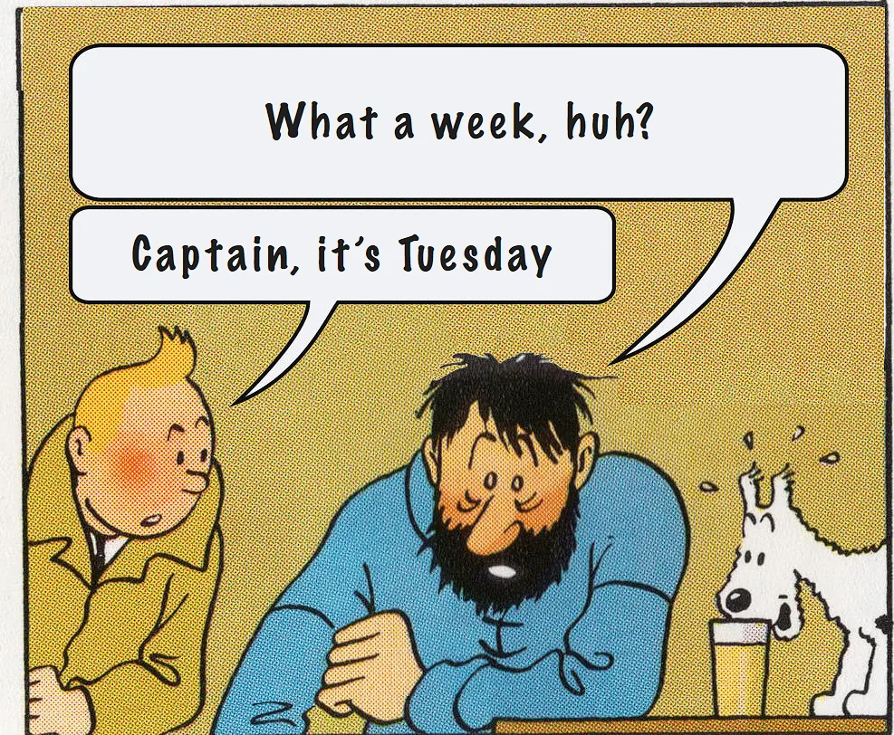
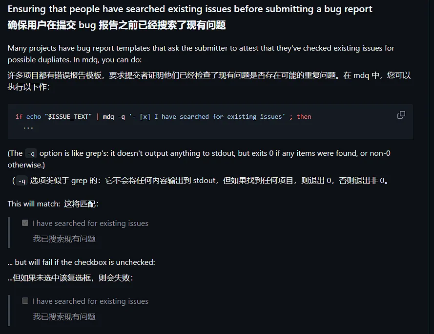

现在的互联网越发无聊，原先的我喜欢在一些论坛常驻，但这些论坛或社群都慢慢消失了。现在在网上我常去的一个社群是豆瓣上的一个生活小组（其实它前身不是什么好地方，但现在变成生活组了）。为了防止我看到一些项目会忘掉，于是我会把一些我觉得有意思的项目都发帖分享到那个组里。

由于许多内容都来自于 Hacker News ，而 Hacker News 有一个版块叫做 SHOW HN ，于是我把这一系列的帖子都归类到 “SHOW 正组” 中。

这些帖子的内容大多聚焦在技术上，但也有一些其他的内容。

以下是我在一月到二月期间看到的内容在筛选（将一些不够实用或不够有趣的过滤）后的汇总。

但是感觉内容看多了后，能引起人兴趣的越来越少了——当然，也可能是因为最近工作很忙的原因。

# 人文或其他领域相关

## 1.Deno的作者发起了让 Oracle 放弃 JavaScript 商标的请愿

JavaScript 的历史是笔糊涂账。简单来讲，便是由于 2009 年 Oracle 收购了注册 JavaScript 商标的 Sun Microsystems（我想学过 Java 的都对这个名字很熟悉）获得了 JavaScript 商标的所有权，但是之后并未积极使用且参与到 JavaScript 标准的制订与社区中来。这导致了社区很难使用 JavaScript 这个名字开展活动，例如为了避免商标侵权 JavaScript 的一系列规范都命名为了 "ECMAScript" ，开展活动使用的是 "JS Conf" 这样的名称。

并且 Oracle 令人发指地在 2019 年续展商标时提交了和 Oracle 风马牛不相及的 Node.js 项目的截图作为商业使用的证据......只能说吃相太难看了。

为此 Deno 的作者发起了让 Oracle 放弃 JavaScript 商标的线上请愿。你可以点击下面的在线请愿地址去签署对应协议。

Deno 作者的 Blog ：[https://deno.com/blog/deno-v-oracle2](https://deno.com/blog/deno-v-oracle2)。

在线请愿地址：[https://javascript.tm/](https://javascript.tm/)

## 2. 滴画绘制网站

Website：[https://jacksonpollock.org/](https://jacksonpollock.org/)

网站域名来自于 Jackson Pollock这个人名，他是美国的抽象画派大师，以油滴画著称。

网站的操作指南：

- 数字设置灰度。
- 字母设定颜色（b=蓝色，r=红色，y=黄色，等等）。
- 鼠标单机设置随机颜色。
- 空格键或双击重置画布。

## 3. 'What a week' meme 的实时更新版本

《What a week》 这个 meme 应该很多人看到过：

有人做了一个实时更新这个 meme 上面的时间的网站，并给出了不同时间段的版本：

- 'What a day': [https://tintin.dlazaro.ca/day](https://tintin.dlazaro.ca/day)  

- 'What a week': [https://tintin.dlazaro.ca/week](https://tintin.dlazaro.ca/week)  

- 'What a month': [https://tintin.dlazaro.ca/month](https://tintin.dlazaro.ca/month)  

- 'What a year': [https://tintin.dlazaro.ca/year](https://tintin.dlazaro.ca/year)  

时间的确认是借助Cloudflare Worker 使用请求 IP（不记录或存储）确定当前时间。因此如果你挂了代理访问这个网站，显示的时区是你代理服务器所在地的时区 :)

## 4. V社的半条命的诞生故事

地址：[https://www.filfre.net/2024/12/half-life/](https://www.filfre.net/2024/12/half-life/)。

## 5. 通过一次性时间码（TOTP）验证双方的身份

Website：[https://ksze.github.io/PeerAuth/](https://ksze.github.io/PeerAuth/)

这个东东主要用来验证双方是不是本人。

步骤是：

1. 访问上面的网址，输入双方姓名

2. 使用 Authenticator 相关的身份验证器，各自扫描上面的二维码，这时便会获取到对应的 TOTP 应用：
   
3. 之后见面的时候，通过身份验证器上彼此的验证码是否一致判断是否是本人。

有点意思的东东。

## 6. 随机看一篇他人的博客

Website:[https://indieblog.page/](https://indieblog.page/)。

这个网站挺好玩的，点击按钮，随机为你打开一篇他人的博客。

## 7. 使用 Typescript 的类型实现 Doom 这个游戏

地址：[https://www.youtube.com/watch?v=0mCsluv5FXA&ab_channel=MichiganTypeScript](https://www.youtube.com/watch?v=0mCsluv5FXA&ab_channel=MichiganTypeScript)。

原po纯使用 Typescript 的类型实现了 Doom 这个经典的射击游戏。
# 重技术内容相关

## 1. 为什么制作一个计算器是非常困难的

Blog:[https://chadnauseam.com/coding/random/calculator-app](https://chadnauseam.com/coding/random/calculator-app)

这篇博文讲述了制作一个精确的计算器程序为什么会这么困难（我是第一次知道 ios 的计算器竟然能那么鸡肋😴😴😴）。计算器的精确性问题主要来源于浮点数表示的误差，使得像是 `(10^100) + 1 − (10^100)` 这样的算数式子会得到错误的结论（作者在 ios 的计算器复刻了这一点）。

目前的解是 Google 那样，结合有理数和递归实数进行计算。

> 递归实数计算（Recursive Real Arithmetic, RRA）是一种表示和计算实数的方法，其核心思想是把每个实数看作一个“计算过程”或函数。这个函数接受一个有理数形式的“容差”作为输入，表示你希望计算的结果与真实值之间的误差不超过这个容差。函数则返回一个有理数近似值，这个值保证在所指定的精度范围内接近真实的实数。

## 2. 个人推荐一个 Typescript 开发者 Snowflyt

Github：[https://github.com/Snowflyt](https://github.com/Snowflyt)。

这是国人，他使用 Typescript 做了不少有趣的项目，比如使用 Typescript 实现高秩类型（higher-kinded type）：[https://github.com/Snowflyt/hkt-core](https://github.com/Snowflyt/hkt-core)。

比如类型测试：[https://github.com/Snowflyt/typroof](https://github.com/Snowflyt/typroof)。

翻阅他的 Github 仓库你能发现很多好玩的在TS的语言与类型层面上的项目，是高手。

## 3. mdq:像是 JQuery 一样的 Markdown 查询器

Github：[https://github.com/yshavit/mdq](https://github.com/yshavit/mdq)。

但感觉用处不是很大，作者给出的示例是在 Github 的协作上，通过 CI/CD 集成 mdq ，以实现一些 checks：

# 他人博客 Mark

- 在行业工作十年后，我对软件开发的看法：[https://chriskiehl.com/article/thoughts-after-10-years](https://chriskiehl.com/article/thoughts-after-10-years)
  “类型是我们对世界做出的断言（Types are assertions we make about the world）”
  “在通用应用开发中，抽象概念很少存在。只需编写你需要的代码。”
  “相反，库开发 _关乎_ 抽象。你需要花时间寻找一种代数（Contrarily, library development is _about_ abstractions. Spend time hunting for an algebra）。”
  喜欢他的话，跟我的观点差不多。
- 发现的一个高手的博客： https://timkellogg.me/blog/archive
- 书写数学相关符号的技巧建议：[https://johnkerl.org/doc/ortho/ortho.html](https://johnkerl.org/doc/ortho/ortho.html)
- 使用 Haskell 实现的滑动窗口算法：[https://byorgey.github.io/blog/posts/2024/11/27/stacks-queues.html](https://byorgey.github.io/blog/posts/2024/11/27/stacks-queues.html)