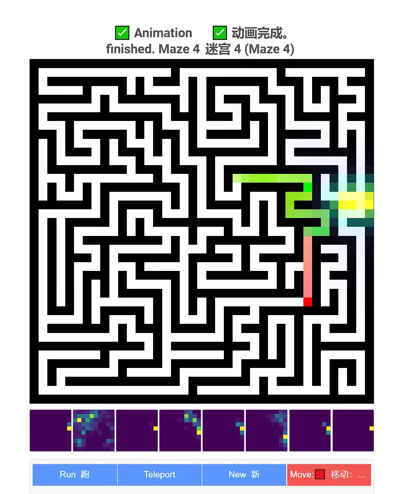
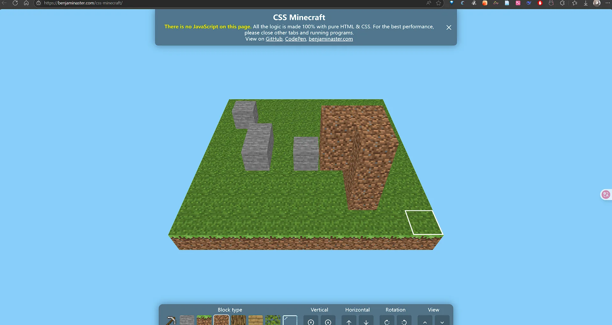
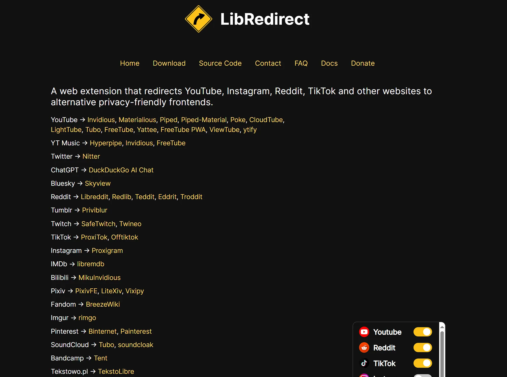
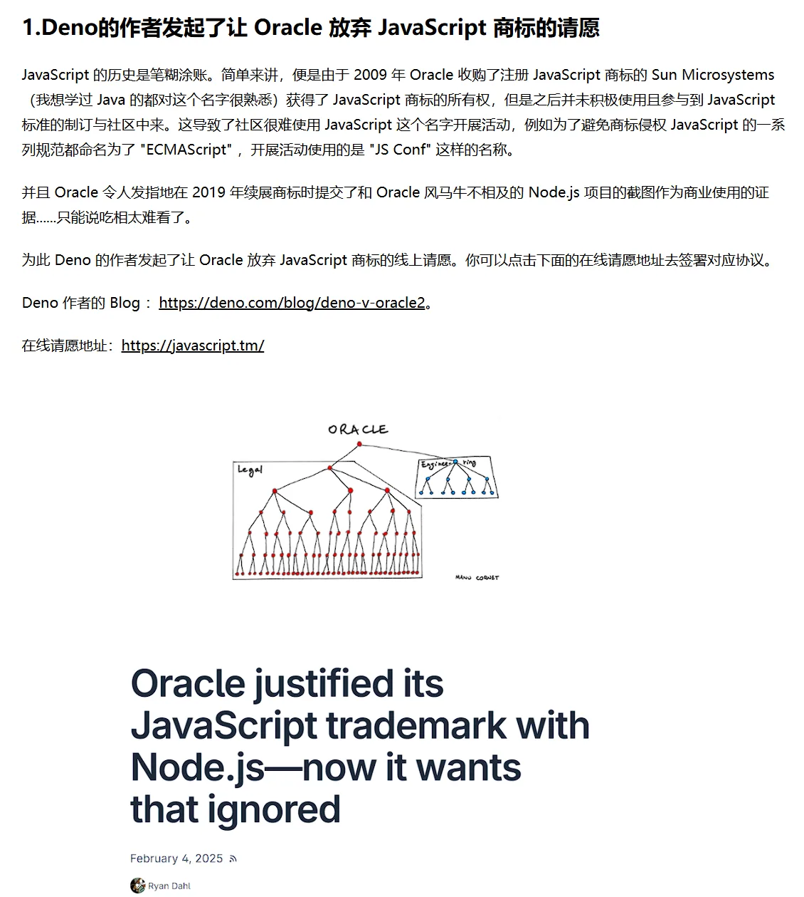
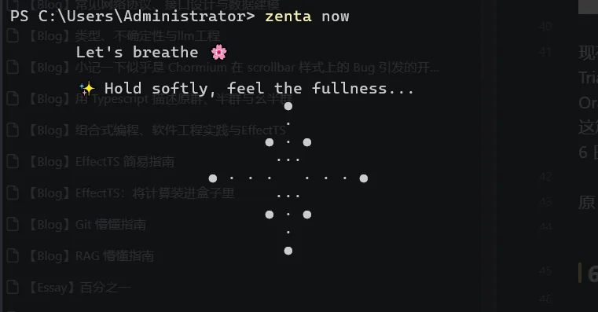
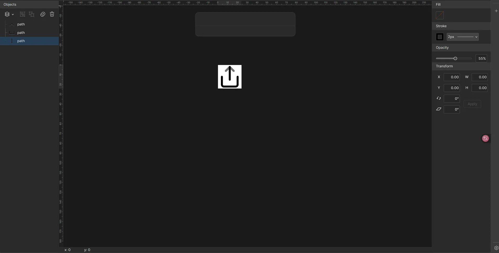
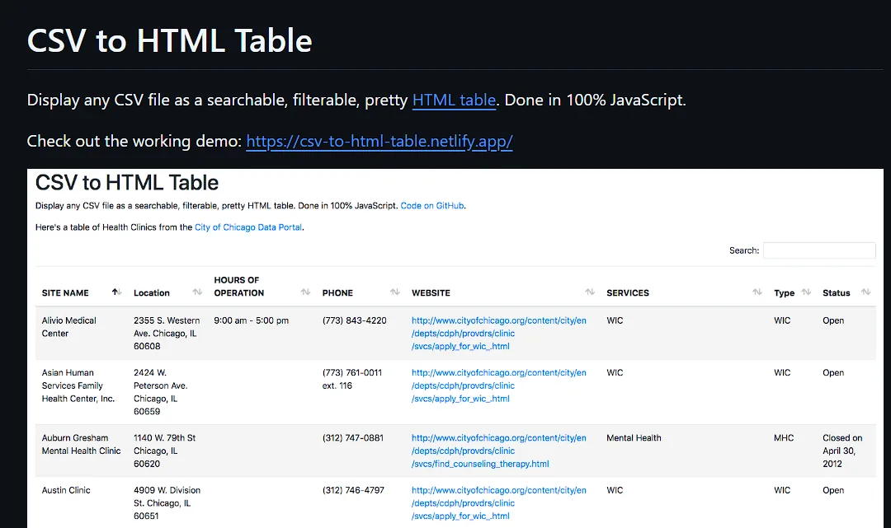
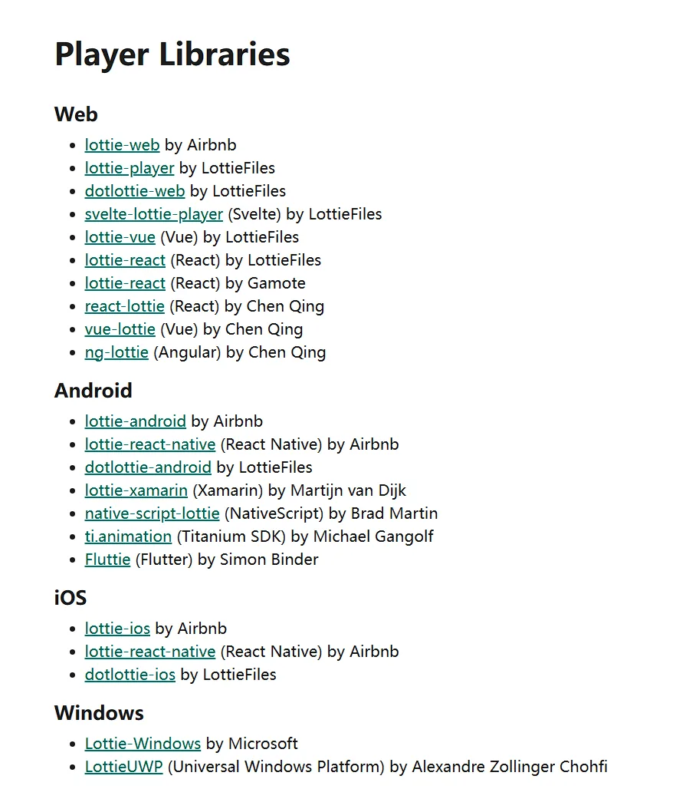
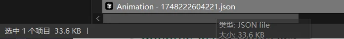

# 简介

现在的互联网越发无聊，原先的我喜欢在一些论坛常驻，但这些论坛或社群都慢慢消失了。现在在网上我常去的一个社群是豆瓣上的一个生活小组（其实它前身不是什么好地方，但现在变成生活组了）。为了防止我看到一些项目会忘掉，于是我会把一些我觉得有意思的项目都发帖分享到那个组里。

由于许多内容都来自于 Hacker News ，而 Hacker News 有一个版块叫做 SHOW HN ，于是我把这一系列的帖子都归类到 “SHOW 正组” 中。

这些帖子的内容大多聚焦在技术上，但也有一些其他的内容。

以下是我在五月到六月期间看到的内容在筛选（将一些不够实用或不够有趣的过滤）后的汇总。

但是感觉内容看多了后，能引起人兴趣的越来越少了——当然，也可能是因为工作很忙的原因。

***

# 人文或其他领域相关

## 1. 持续思考机器 Continuous Thought Machines

Website: [https://pub.sakana.ai/ctm/](https://pub.sakana.ai/ctm/)。

一种新型的神经网络。和大多数神经网络不同的地方在于，它引入了时间同步机制。

这个网站还同样提供了一个可视化的demo：

## 2. 什么是HDR？

Blog：[https://www.lux.camera/what-is-hdr/](https://www.lux.camera/what-is-hdr/)。

应该是我见到的讲得最通俗易懂的关于 HDR（High Dynamic Range，高动态范围） 介绍的博文。这是 Lux Camera 这家公司为消费者对于他们的摄像 App Halide 上线的 HDR 功能的通俗介绍，非常深入浅出。事实证明，商业推文也能有好的科普性。

## 3. 纯CSS+HTML实现的 Minecraft

Website：[https://benjaminaster.com/css-minecraft/](https://benjaminaster.com/css-minecraft/)。

只用 CSS + HTML 实现的一个 Minecraft demo 网站，很 awesome。

## 4. LibRedirect:一个Web导航站，为你提供国外主流社媒的替代前端

Website: [https://libredirect.github.io/](https://libredirect.github.io/)。

简单来讲就是一个列出了所有其他开发者写的国外主流社交媒体的替代前端，你不需要使用对应社交媒体的主要前端网页，做个类比来讲它就是给所有去除了广告版的豆瓣App的索引站。

## 5. JavaScript 商标后续

在今年二月 Deno 的作者发起过让 Oracle 放弃 JavaScript 商标的请愿：

我在 [SHOW 正组 2025 年 1月合辑：leewendao.otterstack.cn/writings/notes/show-douban-zhengzu-2025-jan-feb](/writings/notes/show-douban-zhengzu-2025-jan-feb) 里也提到过这个事情。

现在后续为 6 月 18 日商标审判和上诉委员会（Trademark Trial and Appeal Board, TTAB）驳回了 Deno 作者等人对 Oracle 的欺诈指控。我不太清楚外国司法是怎样的，按照这篇 Blog 的说法，8月7日前 Oracle 必须给出回应，9 月 6 日似乎 Deno 作者又要整活。

原 Blog 地址：[https://deno.com/blog/deno-v-oracle4](https://deno.com/blog/deno-v-oracle4)。

## 6. zenta：给使用终端的用户的正念工具

Github: [https://github.com/e6a5/zenta?tab=readme-ov-file](https://github.com/e6a5/zenta?tab=readme-ov-file)。

说起来其实没什么卵用，但挺有意思的玩意。它本质上是一段写好的终端程序，当你配置到你的环境里输入相应命令，便会提示你跟随屏幕上的提示吸气——呼气，开始正念冥想。

# 技术相关

## 1.ty: 一个更快的 Python 静态类型检查器以及LSP

Github: [https://github.com/astral-sh/ty?tab=readme-ov-file](https://github.com/astral-sh/ty?tab=readme-ov-file)。

我用过的 Python 的静态类型检查器里，体验最好（相较而言，不能说体验极佳，感觉 Python 的静态类型检查器都没那么好用）的是 mypy，但是它非常慢😵 ty 的卖点则是快，它用 Rust 写的。不过可惜的是现在还在一个前期开发阶段，我先 mark 一下。

## 2.Hyvector: Web端运行的Svg编辑器

Website: [https://www.hyvector.com/](https://www.hyvector.com/)。

可惜这只是真【编辑】器，我原本还以为可以绘制图形帮我转化为 SVG。它主要可以用于对 SVG 的各个 part 进行微调（大小、方向、透明度等）：

## 3. 把 csv 快速转换为 html 表格

Github: [https://github.com/derekeder/csv-to-html-table?tab=readme-ov-file](https://github.com/derekeder/csv-to-html-table?tab=readme-ov-file)。

可惜只支持 `csv` 。

## 4. Lottie：开源的基于JSON的动画格式规范

文档链接：[https://lottie.github.io/lottie-spec/latest/](https://lottie.github.io/lottie-spec/latest/)。

其实去年我就看到过这玩意。一句话总结就是：Lottie 是一个用于通过 JSON 去描述矢量动态图形的规范。你可以通过基于该标准描述的JSON去渲染对应的动图。

它的生态看似齐全，但实际上现在更新频率不是很高：

并且试图用 JSON 去描述动画的缺点也是显而易见的，对应的数据文件会非常的大，一个两三秒的小兔子动画就有 `33.6kb` 大小的JSON数据文件：

更为大家推荐的是 rive : [https://rive.app/blog/a-new-graphics-format-for-the-interactive-era](https://rive.app/blog/a-new-graphics-format-for-the-interactive-era)。

## 5. 渐进式 JSON

Blog：[https://overreacted.io/progressive-json/](https://overreacted.io/progressive-json/)。

这篇博客先从深度优先的流式输出JSON讲起，而后讲到广度优先的流式输出JSON讲起，最后过渡到 React 的 React Server Component（RSC，react 的服务端组件）。通俗易懂地讲解了 RSC 的基本原理以及相应的优势，非常好的一篇博文。

## 6. TokenDagger：比 tiktoken 更快的分词器

Github： [https://github.com/M4THYOU/TokenDagger](https://github.com/M4THYOU/TokenDagger)。

tiktoken 是 OpenAI 官方的分词器包，基本上很多市面上的大模型都是用的这个 package。TokenDagger 看 benchmark 比 tiktoken 快很多，在此特地记一下。

# 他人博客 mark

- 继承是作为性能的 Hack 手段发明的：[https://catern.com/inheritance.html](https://catern.com/inheritance.html)。
- [From:Steve Jobs.Great idead,thank you](https://blog.hayman.net/2025/05/06/from-steve-jobs-great-idea.html):https://blog.hayman.net/2025/05/06/from-steve-jobs-great-idea.html 。Apple 元老员工回忆自己在 Steve Jobs 的前公司 NeXT ，收到的 steve 给他发的唯一一封邮件的故事。总结就是他干了件蠢事，把 steve@next.com 这个邮箱转发设置给了自己。
- UI 密度：[https://matthewstrom.com/writing/ui-density/](https://matthewstrom.com/writing/ui-density/)。一篇关于 UI 的信息密度设计的思考。
- Plain Vanilla：[https://plainvanillaweb.com/index.html](https://plainvanillaweb.com/index.html)。一个鼓励你通过[ Web Components](https://developer.mozilla.org/zh-CN/docs/Web/API/Web_components) 去构建 Web 网站的站点，里面存放了作者关于构建这类网站的思考。没什么卵用。但还是记录一下。
- 改变了我对PL的思考的博文：[https://bernsteinbear.com/blog/pl-writing/](https://bernsteinbear.com/blog/pl-writing/)。
- 深度学习是深度的拓扑学：[https://theahura.substack.com/p/deep-learning-is-applied-topology](https://theahura.substack.com/p/deep-learning-is-applied-topology)。一个有趣的视角，以拓扑学的角度去看待深度学习。
- 为何需要代数效应：[https://antelang.org/blog/why_effects/](https://antelang.org/blog/why_effects/)。
- Agent 循环总结：[https://philz.dev/blog/agent-loop/](https://philz.dev/blog/agent-loop/)。
- ”在这个机器批量生产平庸之物的时代，亲手去创造些什么吧。不必完美，粗糙也无妨。只管去创造。（In a moment where machines churn out mediocrity, make something yourself. Make it imperfect. Make it rough. Just make it.）“——[https://dansinker.com/posts/2025-05-23-who-cares/](https://dansinker.com/posts/2025-05-23-who-cares/)
- 大多数人生活在平静的绝望中。——亨利·戴维·梭罗。出自《瓦尔登湖》。
- Clickhouse 团队在Opentelemetry性能不支持大基数下的事件的观测性优化：[https://clickhouse.com/blog/scaling-observability-beyond-100pb-wide-events-replacing-otel](https://clickhouse.com/blog/scaling-observability-beyond-100pb-wide-events-replacing-otel)。 简单来讲就是他们自己写了一套处理日志的流水线。这里仅作mark，万一哪一天就用上了呢？
- 用例子解释布隆过滤器：[https://llimllib.github.io/bloomfilter-tutorial/ ](https://llimllib.github.io/bloomfilter-tutorial/)。
- 函数是向量：[https://thenumb.at/Functions-are-Vectors/](https://thenumb.at/Functions-are-Vectors/)。
- 本地优先软件：[https://www.inkandswitch.com/essay/local-first/](https://www.inkandswitch.com/essay/local-first/)。