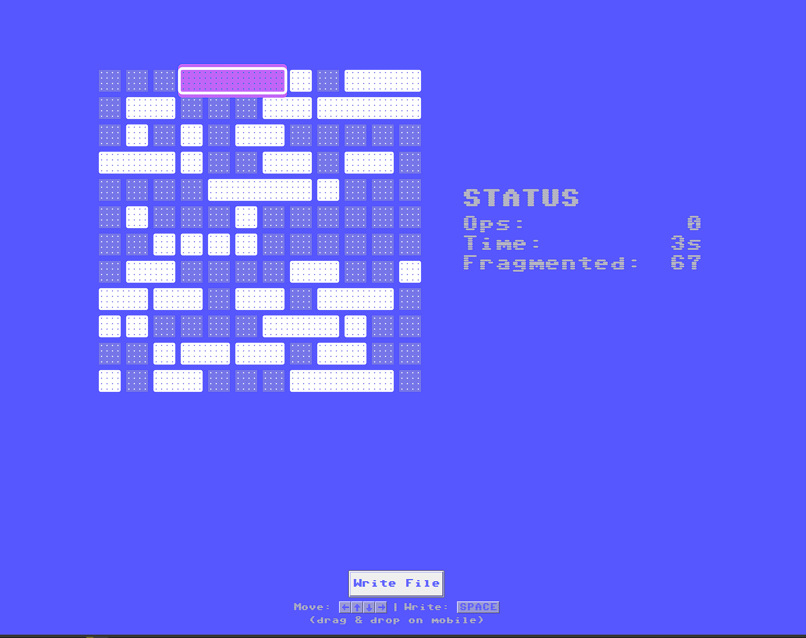
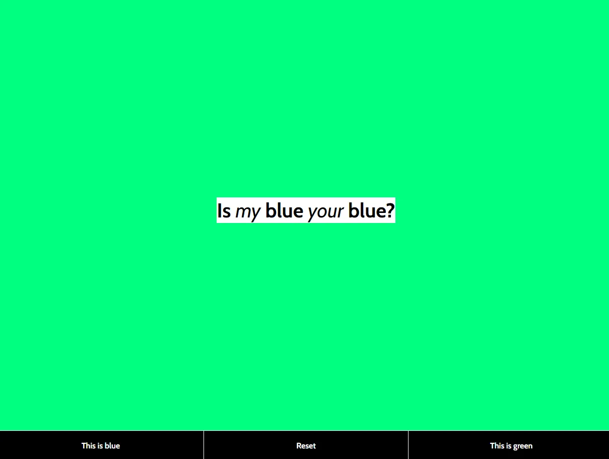
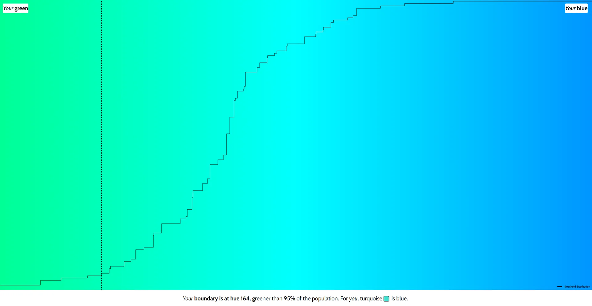
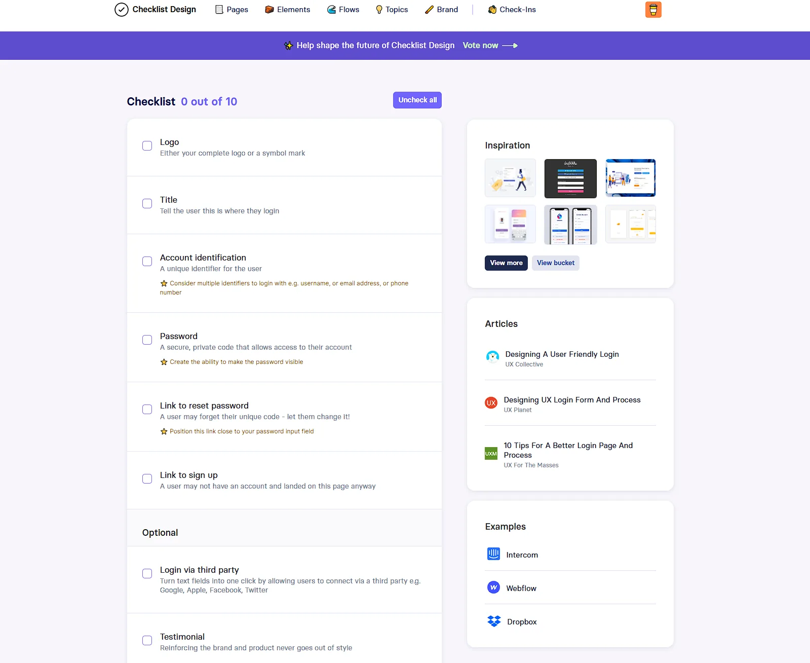
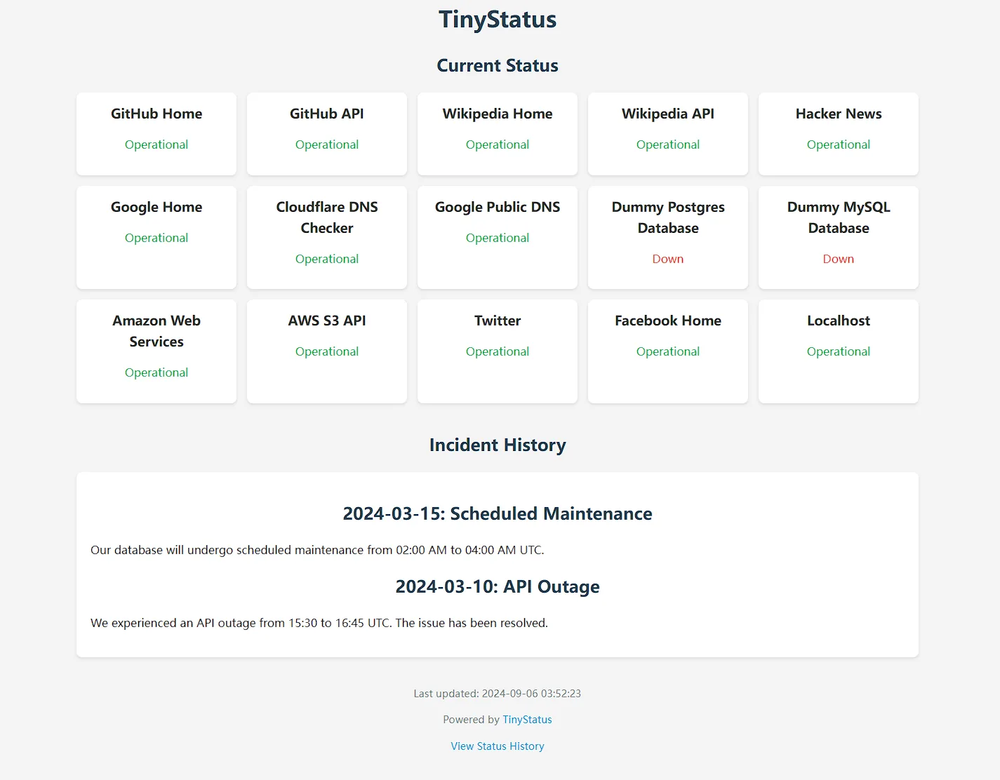
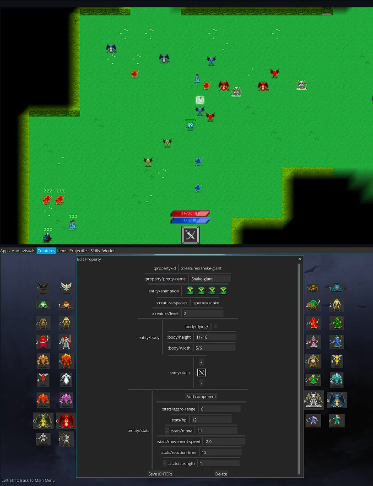
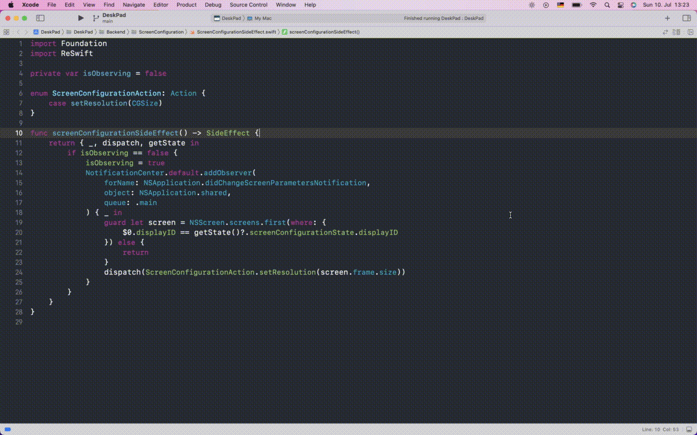
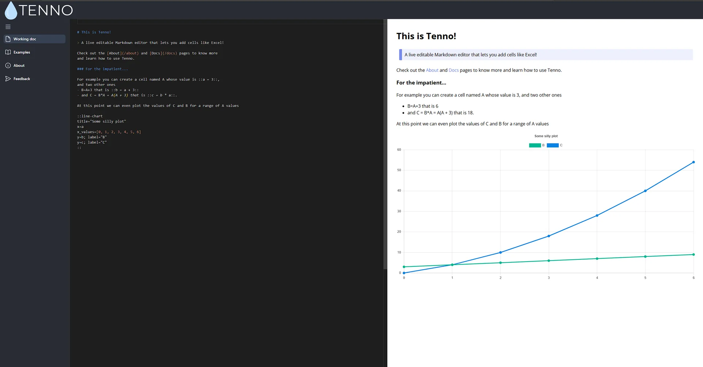
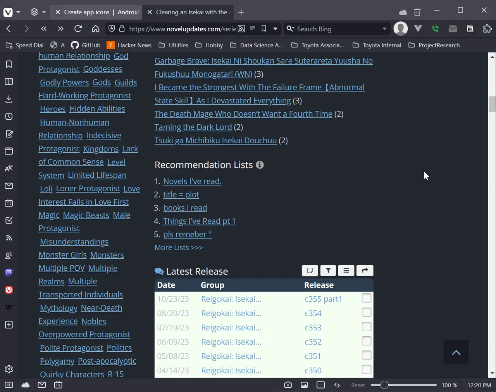

现在的互联网越发无聊，原先的我喜欢在一些论坛常驻，但这些论坛或社群都慢慢消失了。现在在网上我常去的一个社群是豆瓣上的一个生活小组（其实它前身不是什么好地方，但现在变成生活组了）。为了防止我看到一些项目会忘掉，于是我会把一些我觉得有意思的项目都发帖分享到那个组里。

由于许多内容都来自于 Hacker News ，而 Hacker News 有一个版块叫做 SHOW HN ，于是我把这一系列的帖子都归类到 “SHOW 正组” 中。

这些帖子的内容大多聚焦在技术上，但也有一些其他的内容。

以下是我在九月到十月期间看到的内容在筛选（将一些不够实用或不够有趣的过滤）后的汇总。

***
# 人文等其他领域相关

## 1. [磁盘整理网页小游戏-Defrag The Game](https://defrag-game.com/)

Website: [https://defrag-game.com/](https://defrag-game.com/)

Defrag The Game 是一个模拟磁盘整理的网页小游戏。你的目标是移动网页上的磁盘碎片，减少碎片之间的空隙，让数据块紧密排列，从而获得**较低**的评分——是的，它的评分系统是反向的，分数越低越好。



这个游戏的灵感来源于作者在 Youtube 上看到的一个8小时的老式磁盘整理视频：[https://www.youtube.com/watch?v=KR3TbL3Tl6M](https://www.youtube.com/watch?v=KR3TbL3Tl6M)。感兴趣的可以点进去看一下，因为磁盘整理的那个声音真的让人觉得舒服。

## 2. [ismy.blue:测试你对蓝色与绿色的区分标准](https://ismy.blue/)

[ismy.blue](https://ismy.blue) 是一个用于测试你对蓝色与绿色的区分的网站。

点进去后，会随机出现蓝色与绿色色域之间的颜色，你要做的事情便是点击网页下方的按钮，确认这个颜色是蓝色还是绿色：



在几轮测试后便会出现相应的测试结果，给出在你的眼中，你会把什么颜色认为是蓝色：



## 3. [reMarkable Paper Pro：售价三千多块的书写平板，号称跟纸一样的书写体验](https://remarkable.com/store/remarkable-paper/pro)

平板长这样：


说法是在它上面写东西体验跟在纸上写一样。官网上有对于它为什么能做到这一点的解释（实际上是软广）：[https://remarkable.com/using-remarkable/paper-like-writing-and-reading/why-remarkable-paper-pro-feels-like-writing-on-paper](https://remarkable.com/using-remarkable/paper-like-writing-and-reading/why-remarkable-paper-pro-feels-like-writing-on-paper)

总结便是：

1. 显示屏不是纯粹的光滑表面，而是特殊的模仿纸张纹理的屏幕。
2. 低光泽度。
3. 配套的笔手感好。

但是售价 579 刀。真的是令人感慨啊。

## 4. [观点：以兴趣为导向的应用正在逐渐变为新的社交网络](https://news.ycombinator.com/item?id=41479785)

Website: [https://news.ycombinator.com/item?id=41479785](https://news.ycombinator.com/item?id=41479785)

贴到 HN 上的原文讲述了 [网络上的社交社群的重心正在从原本 Twitter 那样的内容广场转变为以兴趣为导向的封闭应用](https://www.theguardian.com/technology/article/2024/sep/08/goodbye-tinder-hello-strava-have-hobby-apps-become-the-new-social-networks)。

我个人也明显感觉到存在这样的趋势，很多传统的内容广场都逐渐冷淡下来，大家都不爱在那种公开的论坛上玩了~

## 5. [在线体验如今的互联网的浏览体验有多糟糕](https://how-i-experience-web-today.com/)

Website:[https://how-i-experience-web-today.com/](https://how-i-experience-web-today.com/)

这个整活网站整合了所有网站的糟糕用户体验，能够让你体验到如今的互联网网站有多让人感到恶心。

谁点进去谁知道。

## 6. [常见的3D电子游戏阴影技术 | 英文](https://30fps.net/pages/videogame-shadows/)

Website: [https://30fps.net/pages/videogame-shadows/](https://30fps.net/pages/videogame-shadows/)

这篇文章综合介绍了所有你能在 3D 电子游戏中见到的阴影技术。


***

# 技术相关

## 1. [checklist.design:网页UI设计的实践学习清单](https://www.checklist.design)

Website: [https://www.checklist.design/](https://www.checklist.design/)

Checklist.degin 是一个网页 UI 设计的实践学习清单。它提供了一系列的 UI 设计的实践清单及相应的示例，里面包括了各种常见的设计元素，比如按钮、表单、导航栏等等。这些清单与示例可以帮助你更好地设计出一个用户体验更好的网页。



## 2.[tbsp：基于树的源代码处理语言](https://git.peppe.rs/languages/tbsp/about/)

Website: [https://git.peppe.rs/languages/tbsp/about/](https://git.peppe.rs/languages/tbsp/about/)

tbsp是一种基于tree-sitter语法树的源代码处理语言，类似于awk，它通过操作tree-sitter语法树来执行源代码转换和分析任务——因此需要搭配 tree-sitter 相关的 parser 使用——特别适用于将复杂的代码结构转化为目标格式，如从Markdown生成HTML。

目前该语言使用 Rust 编写，支持通过 Cargo 构建。但仍处于早期阶段，有很多内容都还没有~

### 示例

例如以下 markdown 文本：

```markdown
    # 1 heading

    content of first paragraph

    ## 1.1 heading

    content of nested paragraph
```

在 [tree-sitter-md](https://github.com/tree-sitter-grammars/tree-sitter-markdown) 的解析下，它会转换为这样的树：

```tree-sitter
  document
    |  section
    |  |  atx_heading
    |  |  |  atx_h1_marker "#"
    |  |  |  heading_content inline "1 heading"
    |  |  paragraph
    |  |  |  inline "content of first paragraph"
    |  |  section
    |  |  |  atx_heading
    |  |  |  |  atx_h2_marker "##"
    |  |  |  |  heading_content inline "1.1 heading"
    |  |  |  paragraph
    |  |  |  |  inline "content of nested paragraph"
```

tbsp 的做法便是使用 tbsp 语言操作这样的语法树。所有的 tbsp 程序是由一系列的 节（stanza） 构成的。它首先开始于一个 `BEGIN` 节，并且存在一个 `END` 节相对应：

```tbsp
    BEGIN {
        int depth = 0;

        print("<html>\n");
        print("<body>\n");
    }

    END {
        print("</body>\n");
        print("</html>\n");
    }
```

在开始节与终止节之间，我们便可以用 `enter` 与 `leave` 关键词标识的节点节（e.g. `enter <the-node-name>`）来操作语法树：

```tbsp
    enter section {
        depth += 1;
    }
    leave section {
        depth -= 1;
    }
```

上边的代码根据语法树上执行的结果为：

```tree-sitter
    document                                 ...  depth = 0 
    |  section <-------- enter section (1)   ...  depth = 1 
    |  |  atx_heading
    |  |  |  inline
    |  |  paragraph
    |  |  |  inline
    |  |  section <----- enter section (2)   ...  depth = 2 
    |  |  |  atx_heading
    |  |  |  | inline
    |  |  |  paragraph
    |  |  |  | inline
    |  |  | <----------- leave section (2)   ...  depth = 1 
    |  | <-------------- leave section (1)   ...  depth = 0 
```

同理，对于标题的转义，便可以根据前边定义的 `depth` 插入：

```tbsp
    enter atx_heading {
        print("<h");
        print(depth);
        print(">");
    }
    leave atx_heading {
        print("</h");
        print(depth);
        print(">\n");
    }

    enter inline {
        print(text(node));
    }
```

相应的根据语法树的执行结果便为：

```tree-sitter
    document                                 ...  depth = 0 
    |  section <-------- enter section (1)   ...  depth = 1 
    |  |  atx_heading <- enter atx_heading   ...  print "<h1>"
    |  |  |  inline <--- enter inline        ...  print ..
    |  |  | <----------- leave atx_heading   ...  print "</h1>"
    |  |  paragraph
    |  |  |  inline <--- enter inline        ...  print ..
    |  |  section <----- enter section (2)   ...  depth = 2 
    |  |  |  atx_heading enter atx_heading   ...  print "<h2>"
    |  |  |  | inline <- enter inline        ...  print ..
    |  |  |  | <-------- leave atx_heading   ...  print "</h2>"
    |  |  |  paragraph
    |  |  |  | inline <- enter inline        ...  print ..
    |  |  | <----------- leave section (2)   ...  depth = 1 
    |  | <-------------- leave section (1)   ...  depth = 0 
```
## 3. [tinystatus:为你生成服务的可访问性状态的监控网页的 Python 脚本](https://github.com/harsxv/tinystatus)

在线演示 Demo: [https://status.harry.id/](https://status.harry.id/)

tinystatus 是一个 Python 脚本，当你配置好环境变量与你想要监控的服务的地址后，它会为你生成一个监控网页，展示你的服务的可访问性状态。支持通过 docker 执行部署。



需要注意的是，它只能检测 HTTP 一类的端点服务的可访问性状态，这是指：服务是否在运行、服务是否可以访问通、访问的状态码是否和预期相符。因此比较适合只需要检测服务是否还在正常运行的场景。当你想快速上线对服务的监控时，可以考虑使用这个项目。

## 4. [core:使用 Clojure 编写的通过函数式编程实现的游戏编辑器（实验性质的小玩意）](https://github.com/damn/core?tab=readme-ov-file)



Github: [https://github.com/damn/core?tab=readme-ov-file](https://github.com/damn/core?tab=readme-ov-file)

这个东西让我觉得有趣的地方在于它是使用 FP 实现的，作者在仓库的 About 里也有说明：

> Experiment - can videogame development be simple?
>
> 实验性质的产物 —— 游戏开发可以变得非常简单么？不，并不能。

虽然简陋，但是看到这种试图通过不同方式去阐述事物的方式者的很好玩。

## 5. [QUIC 在高速网络下并不如你想得那么快](https://arxiv.org/abs/2310.09423)

论文：[QUIC is not Quick Enough over Fast Internet](https://arxiv.org/abs/2310.09423)。

简单科普一下 QUIC，QUIC 是基于 UDP 的传输协议，由 Google 开发，旨在解决 TCP 的一些问题，比如连接的建立时间过长、慢启动等等。然而最新的研究表明，在高速网络环境（带宽超过500 Mbps，甚至达到1+ Gbps的网络连接）下，基于UDP的QUIC+HTTP/3协议栈相比于TCP+TLS+HTTP/2协议栈，在数据传输速率上可能会降低高达45.2%。性能差距随着底层带宽的增加而扩大。

论文里提出的原因是接收方处理开销过高，特别是在数据包过多的情况下，QUIC的ACK开销比较高。

[Hacker News](https://news.ycombinator.com/item?id=41484991)上对此有一些讨论，我看到的有意思的内容大概有：

1. UDP栈 相比于 TCP栈 本身就缺少优化，这也是造成这一点的原因。 
2. 市面上的网卡大多内置处理器解决 TCP/IP 的开销，但是大多没有支持 UDP卸载（UDP offload）。
3. 'The day they come for HTTP/1.1 is the day I die on a hill.'——如果他们要废除 HTTP/1.1，那么我就死给他们看。🤣

## 6. [【仅Macbook可用】DeskPad:用于屏幕分享的模拟屏幕开源软件](https://github.com/Stengo/DeskPad)

Github: [https://github.com/Stengo/DeskPad](https://github.com/Stengo/DeskPad)

使用 Swift 编写的、仅支持 Macbook 的屏幕分享软件。它是解决在较大显示器与较小受众屏幕之间分享整个屏幕的需求的产物。它会创建一个虚拟显示器，并在应用程序窗口中镜像显示，使用户可以创建一个专门的、易于共享的工作区。

效果：



## 7. [CopenhagenBook:在Web应用中常见的认证方式Cookbook](https://thecopenhagenbook.com/)

Website: [https://thecopenhagenbook.com/](https://thecopenhagenbook.com/)

这本 CookBook 列出了常见的 Web 认证方案并且提供了相应的示例。可作为备忘录使用。

## 8. [repopack: 适用于 Node 系项目的项目打包工具，方便将代码提交给AI进行代码询问](https://github.com/yamadashy/repopack)

Github: [https://github.com/yamadashy/repopack](https://github.com/yamadashy/repopack)

这是我最近用的非常舒服的打包工具。如果你在写 Node 相关的项目（或者说，基于 npm 的前端or后端项目），只需要输入这一行命令：

```bash
npx repopack
```

它便会把整个项目的源代码按照可读性强的格式合并为一个文件，方便你通过大部分大模型产品的附带文件提交你的代码仓的上下文：


这样做的优点在于：

1. 帮助LLM生成更准确、更可用的代码（例如，让LLM输出模块的正确导入路径、复用你原有的封装好的代码等）
2. 方便（谁用谁知道）

即使不是 Node 系项目，你也可以通过调用时的指定规则将其他语言的项目进行打包：

```bash
repopack --include "src/**/*.ts,**/*.md"
```

## 9. [Tenno:使用markdown绘制表格等](https://tenno.app/)

Tenno 是一个通过 markdown 绘制表格的工具。根据 [作者的想法](https://tenno.app/about) ，他想做的是混合 Excel 与 Work 的体验的 markdown 编辑器。你可以理解为 markdown 版本的 JuptyBook。

目前 Tenno 还处于一个比较早期的开发状态，只能在它的 Website 上使用：[https://tenno.app/](https://tenno.app/)。此处只是记录一下表示我个人的关注。



## 10. [epublifier: 将网页转换为 epub 的工具](https://github.com/maoserr/epublifier)

Github: [https://github.com/maoserr/epublifier](https://github.com/maoserr/epublifier)

epublifier 是一个能够将网页转为 epub 保存的浏览器插件:



## 11. [我们如何将 Javascript 通过 monorepo 进行管理的 git 仓库的大小缩小 94%](https://www.jonathancreamer.com/how-we-shrunk-our-git-repo-size-by-94-percent/)

Website: [https://www.jonathancreamer.com/how-we-shrunk-our-git-repo-size-by-94-percent/](https://www.jonathancreamer.com/how-we-shrunk-our-git-repo-size-by-94-percent/)

这篇技术博客挺有趣的。

monerepo 是一种项目代理管理方式，它在单个仓库中管理多个项目。但是这种方式管理代码在使用 Git 时会带来额外的仓库占用空间大小。

我个人总结一下，大概是以下这两点需要注意：

1. *不要将数千个文件保存在一个文件夹中* ，因为在 Git 中往文件夹中添加新文件时，会以树的结构记录相应信息。于是当文件数量很多的时候，会创建贼多的树对象（tree object）。
2. 由于 Linus 在早期 Git 开发中引入的文件压缩的代码，改代码会在 `git push` 前检查文件名的后 16 个字符，因此Git 在一些情况下不仅仅会对比单个文件的前后变化差异，还会将来自不同包的文件进行检查。例如对 `repo/packages/foo/CHANGELOG.json` 的修改，Git 还会生成和 `repo/packages/bar/CHANGELOG.json` 的diff对比。


***

# 个人博客

## 翻译

1. [上下文检索技术 Contextual Retriecal - By Anthropic Team](/writings/translations/introducing-contextual-retrieval-anthropic)
2. [沟通中的明托金字塔原则 Minto Pyramid](/writings/translations/minto-pyramid-of-communication)
3. [daemon 这个词在计算机领域中是怎么被解释为"守护进程/系统进程"的?](/writings/notes/where-the-word-daemon-come-from)
4. [Web 浏览器的剪切板是如何存储不同类型的数据的？](/writings/translations/the-webs-clip-board-and-how-it-stores-data-of-diffent-types)
5. [【改译】Cursor 使用教程](/translations/tutorial-of-Cursor-IDE)

## Blog

1. [【Blog】小记一下似乎是 Chormium 在 scrollbar 样式上的 Bug 引发的开发者工具崩溃问题](/writings/blog/chormium-bug-for-scrollbar)
2. [【Essay】一些零碎的胡思乱想 I](/writings/essay/some-thoungts-part-one)
